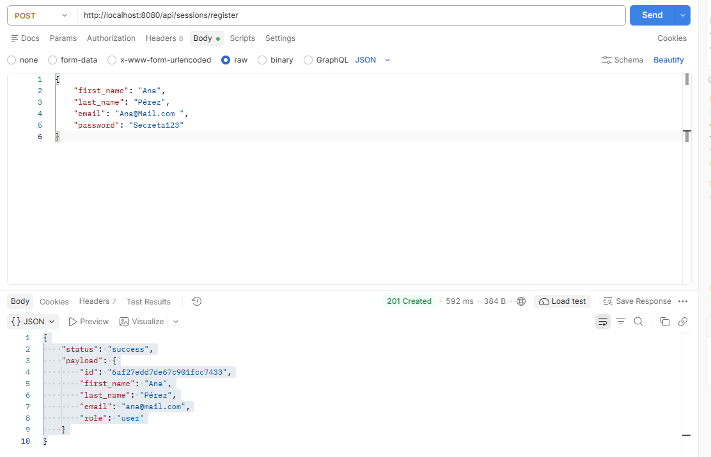
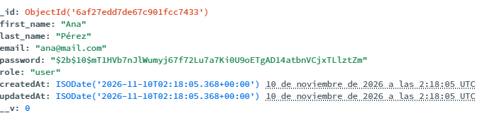

# Torneos Deportivos API

## Descripción

API REST construida con **Node.js**, **Express** y **MongoDB (Mongoose)** para una plataforma de **torneos deportivos**: los organizadores publican torneos y los jugadores se inscriben en ellos.

Proyecto del curso Backend II, organizado por capas y construido por entregas:

| Entrega | Contenido |
|---|---|
| Pre-entrega 1 | Estructura base por capas, configuración de entorno, `GET /api/health` y `GET /api/events` |
| Pre-entrega 2 | Registro seguro de usuarios (`POST /api/sessions/register`): validación, normalización de email, hash de contraseña con bcrypt y persistencia en MongoDB |
| **Pre-entrega 3** | **Autenticación con JWT y cookies**: login, cookie `currentUser` HttpOnly, ruta protegida `GET /api/sessions/current` y logout |

## Temática

**Torneos deportivos con inscripción individual.** Cada jugador se inscribe por su cuenta a un torneo (ajedrez, tenis, pádel, atletismo, e-sports 1v1, etc.).

| Concepto del curso | En este proyecto |
|---|---|
| Event | Torneo |
| Category | Disciplina deportiva (fútbol, ajedrez, pádel…) |
| Inscripción / ticket | Inscripción de un jugador a un torneo |
| Rol `admin` | Administrador de la plataforma |
| Rol `organizer` | Liga, club o federación que crea torneos |
| Rol `user` | Jugador o participante |

## Tecnologías

- Node.js (módulos ESM: `import` / `export`)
- Express 5
- MongoDB Atlas + Mongoose
- dotenv
- bcrypt (hash de contraseñas)
- jsonwebtoken (generación y verificación de JWT)
- cookie-parser (lectura de cookies)

## Instalación

1. Clonar el repositorio:

```bash
git clone https://github.com/DavidZD02/Backend-II---Comision-95280.git
cd Backend-II---Comision-95280
```

2. Instalar las dependencias:

```bash
npm install
```

3. Crear el archivo `.env` a partir de `.env.example` y completar los valores:

```bash
cp .env.example .env
```

## Variables de entorno

| Variable | Descripción | Obligatoria | Por defecto |
|---|---|---|---|
| `PORT` | Puerto del servidor | No | `8080` |
| `NODE_ENV` | Entorno de ejecución (`development` / `production`). En `production` la cookie se envía con `secure: true` | No | `development` |
| `MONGO_URL` | Cadena de conexión a MongoDB Atlas, incluyendo el nombre de la base de datos | **Sí** | — |
| `JWT_SECRET` | Secreto para firmar y verificar los JWT | **Sí** | — |
| `JWT_EXPIRES_IN` | Tiempo de expiración del JWT (formato `15m`, `1h`, `7d`) | No | `1h` |

`.env.example`:

```dotenv
PORT=8080
NODE_ENV=development
MONGO_URL=
JWT_SECRET=
JWT_EXPIRES_IN=1h
```

Ejemplo de `MONGO_URL`:

```
mongodb+srv://<usuario>:<password>@<cluster>.mongodb.net/torneos-deportivos?retryWrites=true&w=majority
```

Para generar un `JWT_SECRET` aleatorio:

```bash
node -e "console.log(require('crypto').randomBytes(32).toString('hex'))"
```

Si falta una variable obligatoria, la aplicación no arranca y muestra cuál falta:

```
Error: faltan las siguientes variables de entorno: MONGO_URL
```

> Si la conexión a Atlas falla por "IP not whitelisted", agrega tu IP en *Security → Network Access* dentro de MongoDB Atlas.

## Ejecución

```bash
npm start      # arranque normal
npm run dev    # modo desarrollo (reinicia al guardar cambios)
```

Si todo sale bien, verás en consola:

```
Conexión a MongoDB exitosa
Servidor corriendo en http://localhost:8080 (development)
```

## Rutas disponibles

Base URL: `http://localhost:8080`

| Método | Ruta | Descripción | Autenticación |
|---|---|---|---|
| GET | `/api/health` | Verifica que el servidor está activo | No |
| GET | `/api/events` | Lista los torneos | No |
| POST | `/api/sessions/register` | Registra un usuario con rol `user` | No |
| POST | `/api/sessions/login` | Valida credenciales y guarda el JWT en la cookie `currentUser` | No |
| GET | `/api/sessions/current` | Devuelve el usuario autenticado | **Sí** (cookie `currentUser`) |
| POST | `/api/sessions/logout` | Elimina la cookie `currentUser` | No |

Todas las respuestas de error tienen la forma:

```json
{ "status": "error", "message": "..." }
```

### `GET /api/health`

Verifica que el servidor está activo.

**Response `200`:**

```json
{ "status": "ok", "message": "Servidor activo" }
```

### `GET /api/events`

Lista los torneos. Recorre todas las capas (`controller → service → repository → DAO → model`).

**Response `200`** (con la base de datos vacía):

```json
{ "status": "success", "payload": [] }
```

### `POST /api/sessions/register`

Registra un nuevo usuario con rol `user`.

**Headers:** `Content-Type: application/json` (también acepta `application/x-www-form-urlencoded`)

#### Campos que espera

| Campo | Tipo | Obligatorio | Reglas |
|---|---|---|---|
| `first_name` | String | Sí | — |
| `last_name` | String | Sí | — |
| `email` | String | Sí | Formato de email válido. Se normaliza con `trim` + `lowercase` antes de validar y guardar. Debe ser único. |
| `password` | String | Sí | Mínimo 6 caracteres. Se guarda hasheada con bcrypt. |

Cualquier otro campo del body se **ignora**. En particular, `role` **no puede enviarse en el registro público**: todo usuario registrado por este endpoint queda con rol `user`.

**Request:**

```json
{
  "first_name": "Ana",
  "last_name": "Pérez",
  "email": "Ana@Mail.com ",
  "password": "Secreta123"
}
```

**Response `201`** (email normalizado y **sin** el campo `password`):

```json
{
  "status": "success",
  "payload": {
    "id": "6af27edd7de67c901fcc7433",
    "first_name": "Ana",
    "last_name": "Pérez",
    "email": "ana@mail.com",
    "role": "user"
  }
}
```

**Response `400`** (datos inválidos). Posibles mensajes:

| Causa | `message` |
|---|---|
| Falta algún campo obligatorio | `Faltan campos obligatorios` |
| Algún campo no es texto (por ejemplo `"email": 12345`) | `Los campos deben ser de tipo string` |
| Email con formato inválido | `Formato de email inválido` |
| Contraseña demasiado corta | `La contraseña debe tener al menos 6 caracteres` |

**Response `409`** (email ya registrado; la comparación se hace sobre el email normalizado):

```json
{ "status": "error", "message": "El email ya está registrado" }
```

### `POST /api/sessions/login`

Valida las credenciales y, si son correctas, genera un JWT y lo guarda en la cookie `currentUser`.

**Request:**

```json
{ "email": "ana@mail.com", "password": "Secreta123" }
```

**Response `200`:**

```json
{ "status": "success", "message": "Login correcto" }
```

Además, la respuesta incluye el header:

```
Set-Cookie: currentUser=<JWT>; Max-Age=3600; Path=/; Expires=...; HttpOnly; SameSite=Lax
```

**Response `400`** (falta `email` o `password`, o no son texto):

```json
{ "status": "error", "message": "Faltan campos obligatorios" }
```

**Response `401`** (el email no existe **o** la contraseña es incorrecta; el mensaje es el mismo en ambos casos):

```json
{ "status": "error", "message": "Credenciales inválidas" }
```

### `GET /api/sessions/current`

Ruta protegida: pasa por el middleware `auth`, que lee la cookie `currentUser` y verifica el JWT.

**Request:** sin body. La cookie `currentUser` se envía automáticamente después del login (Postman y los navegadores la guardan por dominio).

**Response `200`:**

```json
{
  "status": "success",
  "payload": {
    "id": "6af27edd7de67c901fcc7433",
    "email": "ana@mail.com",
    "role": "user"
  }
}
```

**Response `401`** (sin cookie, token manipulado o token expirado):

```json
{ "status": "error", "message": "No autenticado" }
```

### `POST /api/sessions/logout`

Elimina la cookie `currentUser`. No requiere estar autenticado, para que un usuario con un token expirado también pueda limpiar su cookie.

**Request:** sin body.

**Response `200`:**

```json
{ "status": "success", "message": "Sesión cerrada" }
```

### Ruta inexistente

**Response `404`:**

```json
{ "status": "error", "message": "Ruta no encontrada: GET /api/otra-cosa" }
```

## Cómo probar

Con el servidor corriendo, en Postman o Insomnia (Body → raw → JSON). Postman guarda la cookie del login y la envía automáticamente en las siguientes peticiones; para verla, editarla o borrarla, usa el enlace **Cookies** debajo del botón **Send**.

Desde la terminal, `-c` guarda la cookie en un archivo y `-b` la envía:

```bash
curl -X POST http://localhost:8080/api/sessions/register \
  -H "Content-Type: application/json" \
  -d '{"first_name":"Ana","last_name":"Pérez","email":"ana@mail.com","password":"Secreta123"}'

curl -X POST http://localhost:8080/api/sessions/login -c cookies.txt \
  -H "Content-Type: application/json" \
  -d '{"email":"ana@mail.com","password":"Secreta123"}'

curl http://localhost:8080/api/sessions/current -b cookies.txt

curl -X POST http://localhost:8080/api/sessions/logout -b cookies.txt -c cookies.txt

curl http://localhost:8080/api/sessions/current -b cookies.txt   # → 401
```

### Casos verificados

**Registro**

| # | Caso | Resultado esperado |
|---|---|---|
| 1 | Registro exitoso | `201` con email normalizado y sin `password` |
| 2 | Campos faltantes | `400` `Faltan campos obligatorios` |
| 3 | Email con formato inválido | `400` `Formato de email inválido` |
| 4 | Email ya registrado | `409` `El email ya está registrado` |
| 5 | Contraseña en la base de datos | Hash que empieza por `$2b$10$`, nunca el texto plano |
| 6 | Envío de `"role": "admin"` en el body | `201` con `"role": "user"` |

**Autenticación**

| # | Caso | Resultado esperado |
|---|---|---|
| 7 | Flujo completo: registro → login → `/current` → logout → `/current` | `201` → `200` + cookie → `200` → `200` → `401` |
| 8 | Login con email inexistente | `401` `Credenciales inválidas` |
| 9 | Login con contraseña incorrecta | `401` `Credenciales inválidas` (mismo mensaje que el caso 8) |
| 10 | `/current` sin cookie | `401` `No autenticado` |
| 11 | `/current` con token manipulado | `401` `No autenticado` |
| 12 | Payload del JWT | Contiene `id`, `email`, `role`, `iat` y `exp`; nunca `password` |

### Evidencias

**Registro.** Respuesta del registro exitoso (sin el campo `password`):



Usuario guardado en MongoDB Atlas con la contraseña hasheada:



**Login** con la cookie `currentUser` en la respuesta:


**`/current` con cookie** respondiendo `200`:


**`/current` sin cookie** respondiendo `401`:


## Seguridad

### Contraseñas

- **Hash con bcrypt:** la contraseña se transforma con `bcrypt.hash` (10 salt rounds) antes de guardarse. bcrypt agrega un *salt* aleatorio, por lo que dos usuarios con la misma contraseña tienen hashes distintos.
- **Comparación segura:** el login usa `bcrypt.compare` (`isValidPassword`), que vuelve a calcular el hash con el salt guardado; la contraseña nunca se "descifra".
- Ambas funciones están en el helper reutilizable `src/utils/hash.js`.

### Registro

- **Sin password en la respuesta:** el service devuelve un **DTO** (`src/dto/user.dto.js`) que copia solo los campos públicos. Funciona como lista blanca: un campo sensible que se agregue al modelo en el futuro no se expone a menos que se incluya explícitamente.
- **Rol no manipulable:** el service desestructura solo `first_name`, `last_name`, `email` y `password` del body; un `role` enviado por el cliente nunca llega a la base de datos.
- **Email único:** se valida en el service (`409`) y además el modelo define `email` con `unique: true`.

### Login y JWT

- **Mensaje genérico:** si el email no existe o la contraseña es incorrecta, la respuesta es la misma (`401` `Credenciales inválidas`). Así no se puede averiguar qué emails están registrados.
- **Payload mínimo:** el JWT contiene solo `{ id, email, role }` (más `iat` y `exp`, que agrega la librería). El payload de un JWT se puede decodificar sin la clave, por eso **nunca** incluye la contraseña.
- **Firma:** el token se firma con `JWT_SECRET`, leído de las variables de entorno y nunca escrito en el código. Si alguien modifica el payload (por ejemplo, cambia el `role`), la firma deja de coincidir y el token se rechaza.
- **Expiración:** configurable con `JWT_EXPIRES_IN` (por defecto `1h`, igual que la cookie).
- La lógica de firma y verificación está en el helper `src/utils/jwt.js` (`generateToken` y `verifyToken`).

### Cookie `currentUser`

| Opción | Valor | Para qué sirve |
|---|---|---|
| `httpOnly` | `true` | El JavaScript del navegador no puede leer la cookie, lo que protege el token ante ataques XSS |
| `sameSite` | `"lax"` | La cookie no se envía en peticiones originadas desde otros sitios (mitiga CSRF) |
| `maxAge` | `3600000` (1 hora) | Tiempo de vida de la cookie |
| `secure` | `true` solo si `NODE_ENV=production` | La cookie solo viaja por HTTPS en producción; en local se usa `http://` |

Las opciones están definidas una sola vez (`cookieOptions` en `sessions.controller.js`) y se reutilizan en el login y en el logout, ya que `clearCookie` necesita las mismas opciones para que el navegador borre la cookie.

### Middleware `auth`

`src/middlewares/auth.middleware.js` protege las rutas privadas:

1. Lee el token de `req.cookies.currentUser` (disponible gracias a `cookie-parser`).
2. Si no hay token, responde `401`.
3. Verifica el token con `verifyToken`. Si es inválido o expiró, responde `401`.
4. Guarda el payload en `req.user` y llama a `next()`.

Se aplica en el router, antes del controller:

```js
router.get("/current", auth, current);
```

## Manejo de errores

El service y el middleware `auth` lanzan errores con la clase `AppError` (`src/utils/appError.js`), que incluye el código HTTP en la propiedad `status`. El método estático `AppError.assert(condición, mensaje, status)` lanza el error si la condición no se cumple.

Express 5 envía automáticamente los errores de los controllers `async` al middleware `errorHandler`, que responde con `err.status` (o `500` si no existe). Los errores `4xx` siempre muestran su mensaje; los `500` lo ocultan en producción para no exponer detalles internos.

## Arquitectura

Cada capa tiene una sola responsabilidad y solo conoce a la capa inmediatamente inferior:

```
Request → routes → (middlewares) → controllers → services → repositories → dao → models → MongoDB
```

Flujo del login:

```
POST /api/sessions/login
  → sessions.router        conecta la ruta con el controller
  → sessions.controller    pide el token al service, lo guarda en la cookie y responde 200
  → sessions.service       valida, normaliza el email, busca el usuario, compara con bcrypt y genera el JWT
  → users.repository       intermediario sin lógica
  → users.dao              findOne con Mongoose
  → User (modelo)
```

Flujo de `/current`:

```
GET /api/sessions/current
  → sessions.router
  → auth.middleware        lee la cookie, verifica el JWT y guarda el payload en req.user
  → sessions.controller    responde { id, email, role } a partir de req.user
```

| Capa | Responsabilidad |
|---|---|
| **config/** | Carga y valida las variables de entorno (`env.config.js`) y conecta a MongoDB (`database.config.js`). |
| **routes/** | Definen URLs y métodos HTTP, aplican middlewares y delegan en el controlador. Se crean con *factories* que reciben el service. |
| **controllers/** | Leen la petición, llaman al service y arman la respuesta HTTP (incluidas las cookies). |
| **services/** | Lógica de negocio: validaciones, normalización, reglas. No conocen `req` ni `res`. |
| **repositories/** | Intermediarios entre services y DAO. No saben qué base de datos hay debajo. |
| **dao/** | Única capa que habla con Mongoose. |
| **models/** | Schemas de Mongoose (`User`, `Event`). |
| **dto/** | Definen qué datos salen hacia el cliente (`UserDTO`). |
| **middlewares/** | Autenticación (`auth`), rutas no encontradas (404) y manejo de errores. |
| **utils/** | Helpers reutilizables: bcrypt (`hash.js`), JWT (`jwt.js`) y errores con status (`appError.js`). |

Las dependencias se inyectan por constructor en `app.js` (`DAO → Repository → Service → Router`), por lo que ninguna capa crea sus propias dependencias. Ni `app.js` ni las rutas contienen lógica de JWT, bcrypt o validación.

`app.js` configura Express (middlewares de parseo, routers y composición de capas) y lo exporta; `server.js` conecta a la base de datos y levanta el servidor. Separarlos permite testear la app sin abrir un puerto.

## Modelos

### `User` (jugador / organizador / admin)

```js
{
  first_name: String,   // obligatorio
  last_name: String,    // obligatorio
  email: String,        // obligatorio, único, guardado en minúsculas y sin espacios
  password: String,     // obligatorio, guardado como hash de bcrypt
  role: String          // "admin" | "organizer" | "user" (por defecto "user")
}
```

### `Event` (torneo)

```js
{
  title: String,        // nombre del torneo
  description: String,
  date: Date,           // fecha del torneo
  location: String,     // sede
  capacity: Number,     // cupo máximo de jugadores (mínimo 1)
  organizer: ObjectId   // referencia al User que creó el torneo
}
```

Ambos modelos incluyen `createdAt` y `updatedAt` (`timestamps: true`).

## Estructura de carpetas

```
Backend-II---Comision-95280/
├── src/
│   ├── app.js
│   ├── server.js
│   ├── config/
│   │   ├── env.config.js
│   │   └── database.config.js
│   ├── routes/
│   │   ├── health.router.js
│   │   ├── events.router.js
│   │   └── sessions.router.js
│   ├── controllers/
│   │   ├── health.controller.js
│   │   ├── events.controller.js
│   │   └── sessions.controller.js
│   ├── services/
│   │   ├── events.service.js
│   │   └── sessions.service.js
│   ├── repositories/
│   │   ├── events.repository.js
│   │   └── users.repository.js
│   ├── dao/
│   │   ├── events.dao.js
│   │   └── users.dao.js
│   ├── models/
│   │   ├── User.js
│   │   └── Event.js
│   ├── dto/
│   │   └── user.dto.js
│   ├── middlewares/
│   │   ├── auth.middleware.js
│   │   ├── notFound.middleware.js
│   │   └── errorHandler.middleware.js
│   └── utils/
│       ├── hash.js
│       ├── jwt.js
│       └── appError.js
├── docs/
│   ├── register-postman.png
│   ├── register-atlas.png
│   ├── login-cookie.png
│   ├── current-200.png
│   └── current-401.png
├── .env.example
├── .gitignore
├── package.json
└── README.md
```